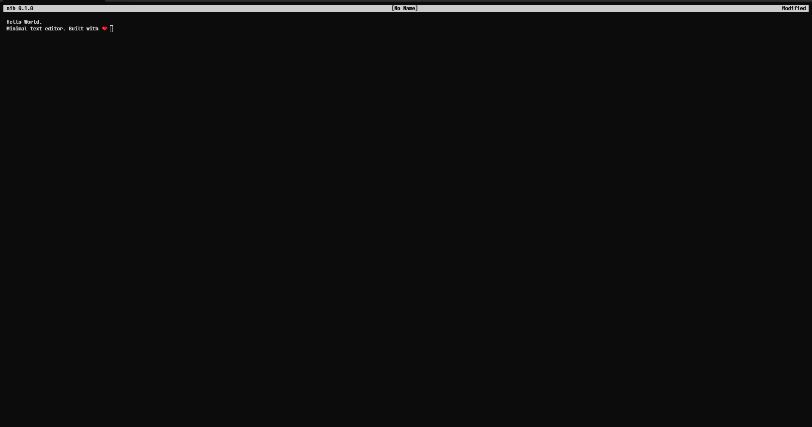
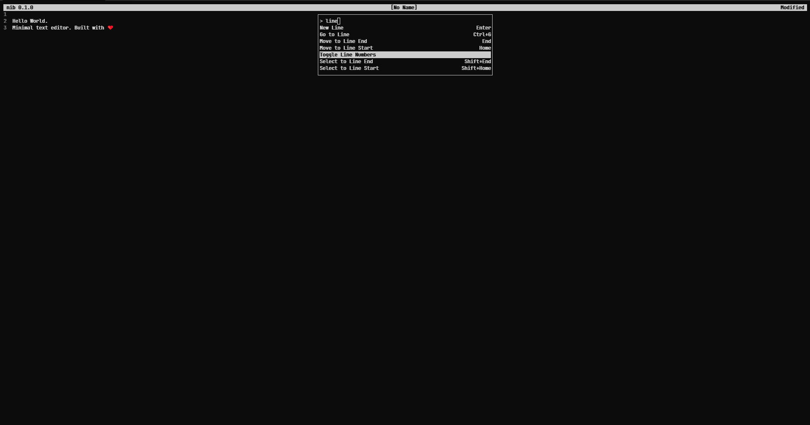
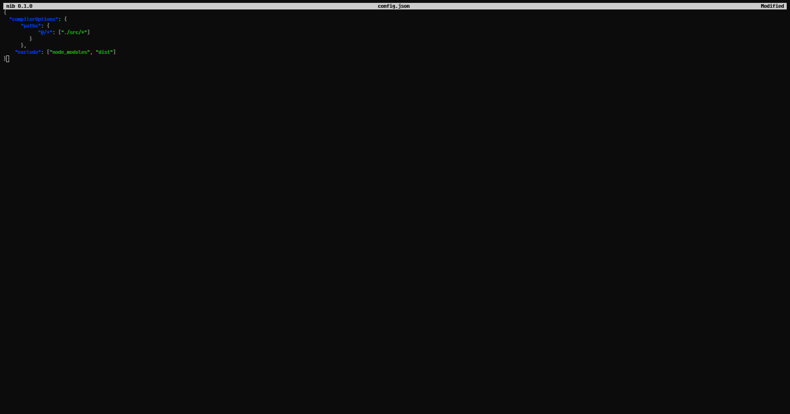

# ✒️ nib

**A small, fast, distraction-free text editor for the terminal, in the spirit of nano.**

Open a file, type, press **Ctrl+S**. Forgot a key? Press **Ctrl+P** and the command palette lists
every command with its keys.



## ✨ Features

- 🛡️ **Safe saves:** every save is atomic. A file is never left half-written.
- 💾 **Crash recovery:** unsaved changes are kept in a recovery file and offered back after a crash.
- 🔒 **One writer per file:** a second nib on the same file opens it read-only.
- 🎯 **Command palette:** **Ctrl+P** finds any command by name, with fuzzy search.
- 🎨 **Markdown and JSON highlighting** in your terminal's own colours.
- ⌨️ **Familiar keys:** Ctrl+S, Ctrl+C, Ctrl+V, Ctrl+Z… and every key can be changed.
- 🖱️ **Mouse:** click, drag to select, double-click a word, scroll.
- 📋 **Clipboard everywhere:** system clipboard, or your terminal's (OSC 52) over SSH.
- 📝 **Keeps your file's format:** line endings, BOM and final newline stay as they were.
- 🪶 **Tiny:** one small binary with no runtime.

<table>
<tr>
<td></td>
<td></td>
</tr>
<tr>
<td align="center">🎯 Command palette</td>
<td align="center">🎨 Syntax highlighting (Markdown and JSON)</td>
</tr>
</table>

## 📦 Install

Supported: 🐧 Debian, Ubuntu, Fedora (x86_64) · 🪟 Windows 10 / 11 (x64).

**🐧 Linux**

```sh
curl -fsSL https://raw.githubusercontent.com/StrandedDev/nib/main/install.sh | sh
```

Installs the `.deb` (Debian, Ubuntu) or `.rpm` (Fedora). Add `-s -- --user` after `sh` to
install into `~/.local/bin` without root. Uninstall with `sudo apt remove nib` / `sudo dnf remove
nib`, or `sh -s -- --uninstall` for a user install.

**🪟 Windows** (PowerShell)

```powershell
irm https://raw.githubusercontent.com/StrandedDev/nib/main/install.ps1 | iex
```

Installs the `.msi` and adds nib to `PATH`. Uninstall from *Settings → Apps*.

To update, run the same command again. Open a new terminal after installing.

**📥 By hand:** the [releases page](https://github.com/StrandedDev/nib/releases) has a `.deb`,
`.rpm`, Linux `.tar.gz`, Windows `.msi` and portable `.zip`, plus `SHA256SUMS`.

> [!NOTE]
> Windows builds are not code-signed. If SmartScreen shows *Windows protected your PC*, click
> **More info**, then **Run anyway**.

## 🔧 Build from source

Needs [Rust](https://rustup.rs) 1.85 or later.

```sh
cargo install --git https://github.com/StrandedDev/nib
```

Or clone and build:

```sh
git clone https://github.com/StrandedDev/nib
cd nib
cargo build --release
```

The binary is `target/release/nib` (`target\release\nib.exe` on Windows), inside the repo folder.

## 🚀 Usage

```
nib                 empty buffer; the first save asks for a name
nib todo.md         open todo.md, or create it on first save
nib app.log:42      open app.log at line 42
nib --help          options, main keys and where your config lives
```

| Key | Does |
|---|---|
| Ctrl+P | Command palette (every command) |
| Ctrl+S / Ctrl+Q | Save / Quit |
| Ctrl+F / Ctrl+R | Find / Replace |
| Ctrl+Z / Ctrl+Y | Undo / Redo |
| Ctrl+G | Go to line |

## ⚙️ Configuration

Optional. One TOML file: `~/.config/nib/config.toml` on Linux, `%APPDATA%\nib\config.toml` on
Windows.

```toml
wrap = true            # soft-wrap long lines
line_numbers = false
tab_width = 4          # 1 to 8; overrides the detected indent width
line_ending = "lf"     # "lf" or "crlf", for new files

[keys]
save_as = "ctrl+shift+s"
redo = ["ctrl+y", "ctrl+shift+z"]
```

A key is modifiers (`ctrl`, `alt`, `shift`) joined with `+` to one key, such as `ctrl+shift+s` or
`f2`. An empty list (`find = []`) leaves a command palette-only. A mistake in the file makes nib
use all defaults and show `Config error: …`.

<details>
<summary>All <code>[keys]</code> names</summary>

`palette`, `save`, `save_as`, `open`, `quit`, `find`, `find_next`, `find_prev`, `replace`,
`goto_line`, `undo`, `redo`, `copy`, `cut`, `paste`, `select_all`, `toggle_wrap`,
`toggle_line_numbers`, `left`, `right`, `up`, `down`, `word_left`, `word_right`, `home`, `end`,
`page_up`, `page_down`, `file_start`, `file_end`, `sel_left`, `sel_right`, `sel_up`, `sel_down`,
`sel_word_left`, `sel_word_right`, `sel_home`, `sel_end`, `backspace`, `delete`,
`delete_word_back`, `delete_word_fwd`, `newline`, `tab`

</details>

## 📚 More

- [How nib works inside](docs/INTERNALS.md)
- [Full specification](SPEC.md)
- [Changelog](CHANGELOG.md)

## 📄 License

[MIT](LICENSE)
